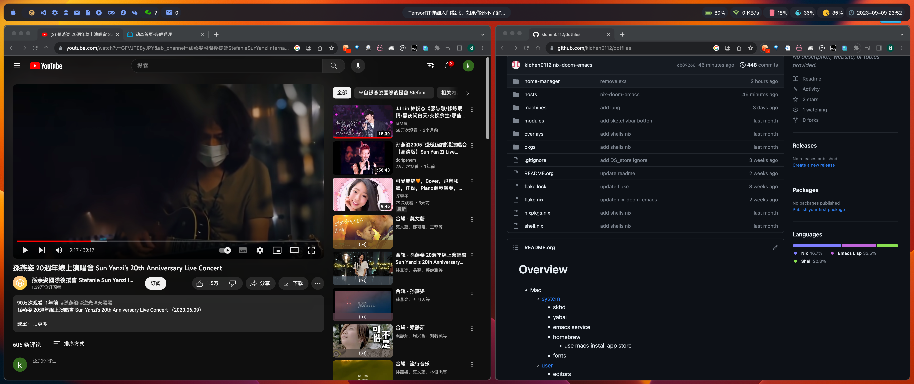

* Overview

|                         | Mac                       | Linux              |
| Window Manager          | hammersponn paperwm.spoon | niri               |
| Status Bar              | sketchybar                | waybar             |
| Terminal Emulator       | ghostty                   | ghostty            |
| Application Runner      | spotlight                 | noctalia           |
| Notification Manager    |                           |                    |
| Editors                 | Emacs,VSCode              | Emacs              |
| Color scheme            | Stylix                    | stylix             |
| Input method framework  | Squirrel                  | fcitx5 with rime   |
| System resource monitor | btop                      |                    |
| Shell                   | nushell + starship        | nushell + starship |

** Directory
#+begin_src shell

  .
├── assets
├── hsts
├── modules
│   ├── access-tokens
│   ├── aria2
│   ├── bar
│   ├── browser
│   │   ├── chrome
│   │   └── zen
│   ├── common
│   ├── darwin
│   ├── de
│   │   ├── aero-sketchybar
│   │   ├── aerospace
│   │   ├── cosmic
│   │   ├── gnome
│   │   ├── hyprspace
│   │   ├── niri
│   │   ├── omniwm
│   │   └── sway
│   ├── docker
│   ├── editor
│   │   ├── emacs
│   │   ├── jetbrains
│   │   └── vscode
│   ├── flake
│   ├── flatpak
│   ├── fonts
│   ├── git
│   ├── hammerspoon
│   │   ├── config
│   │   └── module
│   ├── hardware
│   ├── homebrew
│   ├── hosts
│   │   ├── a99r50
│   │   ├── i12r20
│   │   ├── init
│   │   ├── mbp-m1
│   │   ├── r2070
│   │   ├── sanjiao
│   │   └── wsl
│   ├── i18n
│   ├── im
│   ├── inputmethod
│   ├── keyboard
│   ├── lang
│   │   ├── cpp
│   │   ├── csharp
│   │   ├── go
│   │   ├── java
│   │   ├── json
│   │   ├── julia
│   │   ├── k8s
│   │   ├── latex
│   │   ├── lua
│   │   ├── markdown
│   │   ├── python
│   │   ├── rust
│   │   ├── web
│   │   └── yaml
│   ├── launcher
│   │   └── walker
│   ├── media
│   ├── network
│   ├── nix
│   ├── nix-index
│   ├── nixos
│   ├── notes
│   ├── office
│   ├── qt
│   ├── server
│   ├── shell
│   │   ├── bash
│   │   ├── fish
│   │   ├── nushell
│   │   ├── starship
│   │   └── zsh
│   ├── ssh
│   ├── stylix
│   ├── sync
│   ├── system
│   ├── terminal-emulator
│   │   ├── alacritty
│   │   ├── ghostty
│   │   ├── kitty
│   │   └── wezterm
│   ├── users
│   ├── utils
│   └── visualisation
├── pkgs
│   └── by-name
│       ├── hammerspoons
│       ├── Jigmo
│       ├── org-reminders
│       ├── rime-combo-snow-pinyin
│       ├── sf-mono-liga
│       ├── SF-Pro
│       ├── sf-symbols
│       └── sketchybarhelper
├── scripts
└── secrets
#+end_src
** Mac Desktop

** User / Host roles

在 =den.hosts.<system>.<host>.users.<user>.roles= 中声明用户需要的 role。
=modules/den.nix= 会将本机所有用户的 roles 自动合并到 host roles，并去重。
显式声明的 host roles 仍会合并保留；只属于 host 的 role 不会自动分配给用户。

#+begin_src nix
  den.hosts.x86_64-linux.example = {
    roles = [ "host-only" ];
    users.klchen.roles = [ "python" "llm-agents" ];
  };
  # 最终 host.roles 包含 host-only、python、llm-agents。
#+end_src

禁用某个用户的 role 时，从该用户的 roles 中删除或注释即可；
只删除 host 中的条目不会禁用用户声明的 role。

* Installation
** Nix Darwin Installation
*** Setup
#+begin_src
mkdir -p ~/.config/nix
echo "experimental-features = nix-command flakes" >> ~/.config/nix/nix.conf
#+end_src
*** Initial

#+begin_src
  curl -L https://nixos.org/nix/install | sh
  nix-build https://github.com/LnL7/nix-darwin/archive/master.tar.gz -A installer
  ./result/bin/darwin-installer
  nix-env -iA nixpkgs.git
  git clone https://github.com/klchen0112/dotfiles path/to/config
  cd path/to/config
  # change your username in flake.nix

  # for rebuild
  make up
#+end_src

* Thanks
- [[https://github.com/julian-heng/yabai-config/][julian-heng/yabai-config]]
- [[https://github.com/FelixKratz/dotfiles][FelixKratz/dotfiles]]
- [[https://github.com/camspiers/dotfiles][camspiers/dotfiles]]
- [[https://git.sr.ht/~gagbo/doom-config/tree/master/item/modules/completion/corfu][~gagbo/doom-config]]
- [[https://github.com/Ruixi-rebirth/melted-flakes.git][Ruixi-rebirth/melted-flakes]]
- [[https://github.com/Ruixi-rebirth/flakes.git][Ruixi-rebirth/flakes]]
- [[https://github.com/ryan4yin/nix-config.git][ryan4yin/nix-config]]
- [[https://github.com/Rashad-707/dotfiles][Rashad-707/dotfiles]]
- [[https://github.com/linuxmobile/kaku.git][linuxmobile/kaku]]
- [[https://github.com/dileep-kishore/nixos-config][dileep-kishore/nixos-config]]
- [[https://github.com/khaneliman/khanelinix][khaneliman/khanelinix]] sketchybar configs
- [[https://dendrix.oeiuwq.com][dendrix]]
